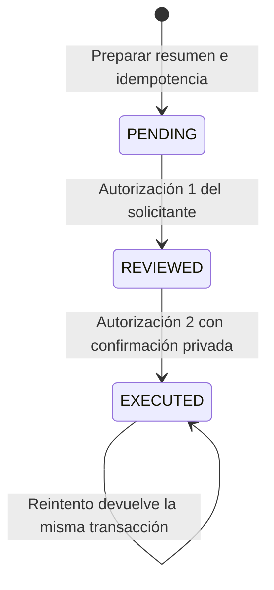

# Billetera: optimización y utilidad real

## Decisión

La estructura sirve como registro interno de saldos y movimientos, con un contrato
reutilizable para los tres sistemas. No se acredita que custodie dinero bancario,
concilie pagos externos o sustituya contabilidad. ERP y Turismo exponen el mismo
contrato, pero mantienen bases e identidades independientes. Analemática aún no
dispone de una integración financiera autenticada con este dominio: no se enlazaron
directamente sus tablas ni se confundieron JWT o IDs entre servicios.

## Hallazgos corregidos

- Edición de propietario y alta arbitraria de monederos por API: ahora solo consulta.
- Acciones por ID sin comprobar propiedad: se consulta el objeto autorizado primero.
- Depósitos sin comprobante, liquidación simulada, reembolsos incompletos, retenciones
  sin propiedad y movimientos arbitrarios: conservan sus interfaces y responden 503.
- Los eventos automáticos no representan autorizaciones. Rechazan expresamente
  pagos sin ejecución, en vez de registrar un éxito en el bus.
- El admin Django deja de permitir altas, cambios y borrados financieros directos.
- Plantillas de agentes dejaban pasar IDs ficticios, firmas o dictámenes de riesgo:
  quedan explícitamente pendientes. No se presentan como auditoría realizada.
- El hash nuevo se calcula después de obtener el timestamp real e incluye importe,
  tipo y referencias. El guardado normal de movimientos existentes se rechaza.
  Es un control de detección, no firma digital ni protección frente a un administrador
  de base capaz de modificar registros y recalcular hashes. Los hashes antiguos
  requieren auditoría; no fueron reescritos.

## Transferencia interna implementada

Preparar no mueve saldo. Revisar tampoco. Ejecutar exige el mismo administrador
activo que posee el origen, el resumen exacto y un token de confirmación que solo
se devuelve en la primera aprobación. Se guarda su hash, no el token. La intención
vence a los 15 minutos. No puede editarse por API. Los monederos deben estar activos,
tener moneda coincidente y conocida (COP/USD/EUR), saldo suficiente y límites
explícitos por operación/día. Si el límite exige gobierno adicional, este flujo se
rechaza: las dos confirmaciones no sustituyen ese requisito.

Se bloquean filas en orden estable y se usan actualizaciones condicionales dentro
de una transacción. Débito, crédito, dos movimientos y estado de intención se
confirman juntos. Un fallo revierte todo. La clave de idempotencia pertenece al
solicitante y al contenido: reutilizarla con otra operación falla. Repetir la misma
ejecución devuelve su transacción y no otro cargo. No hay comisiones implícitas,
conversión de divisas ni confirmación automática de reservas.

## Contrato API

Base canónica en ERP y Turismo: `/api/v1/finance/wallet/`, con autenticación Django
del servicio seleccionado. Las respuestas privadas llevan `Cache-Control: no-store`.

1. `GET accounts/`: saldos propios, moneda y estado; sin metadatos privados.
2. `POST transfers/`: `source`, `destination`, `amount`, `idempotency_key` UUID.
   Devuelve el resumen con `digest`, estado y vencimiento.
3. `POST transfers/{id}/review/`: `digest`. Primera autorización; devuelve
   `confirmation` privado. Debe mostrarse el resumen al administrador antes.
4. `POST transfers/{id}/execute/`: `digest`, `confirmation`. Segunda autorización.
   Debe ser una acción humana separada; el cliente no debe encadenarla automáticamente.
5. `GET transfers/{id}/`: estado propio para resolver un resultado incierto.
6. `GET transactions/`: transacciones relacionadas; cada usuario ve solo sus propios
   movimientos. No se publica el conjunto de contrapartes ni los metadatos internos.

Un error de base no asegura que no hubo commit: se indica consultar la intención y
conservar la clave antes de reintentar. Si se pierde el token antes de ejecutar,
ningún saldo fue debitado; la intención vencerá y se podrá preparar otra. No hay
un cliente web de transferencias nuevo en este corte; se probaron las APIs HTTP.
El servidor registra dos solicitudes autenticadas separadas; eso no demuestra
presencia humana por sí solo. Las pantallas de confirmación y autenticación
reforzada del cliente continúan pendientes.

## Habilitación y datos

`WALLET_INTERNAL_TRANSFERS_ENABLED` está desactivado por defecto. Solo el perfil
`fresh-local-v1` permite activarlo explícitamente para pruebas locales. No cambia
Compose productivo, no inicia transferencias ni configura monedas/límites por
suposición. Los monederos antiguos reciben moneda vacía, quedan sin clasificar y
no pueden transferir. La clasificación y procedencia de saldos requieren revisión
antes de habilitar un entorno con fondos reales.

Se respaldaron las dos bases nuevas antes de aplicar la migración añadida, con
restauración verificada. Solo se migraron esas instalaciones SQLite privadas. Las
cinco bases auxiliares recuperadas anteriormente se conservaron intactas. El
historial heredado no se sustituyó ni se usó `--fake`.

## Pruebas y alcance pendiente

97 ejecuciones correctas: 64 de regresión de dominio/CRM/arranque/preparación,
15 específicas de billetera, 16 en ambas bases migradas y 2 de respaldos. Incluyen
doble aprobación, propiedad, límites, caducidad, importes inválidos, repetición,
fallo atómico, privacidad, API de solo consulta y rechazo de agentes heredados.
En las bases migradas se prueba el recorrido HTTP completo; sus registros
sintéticos se revierten. Los clientes de prueba inyectan identidades autenticadas;
no se certifica aquí un login real ni presencia humana. Evidencia: `wallet-evidence.json`. CI incorpora la suite.

Pendientes: conciliación y procedencia de fondos históricos, proveedor de cobro y
retiro sandbox, reembolsos compensatorios autorizados, contabilidad integrada,
cliente visual de doble aprobación, identidad entre plataformas, pruebas de
concurrencia/carga en PostgreSQL y revisión de requisitos aplicables a dinero real.
No se declara cerrado el plan maestro ni habilitada producción por este corte.
