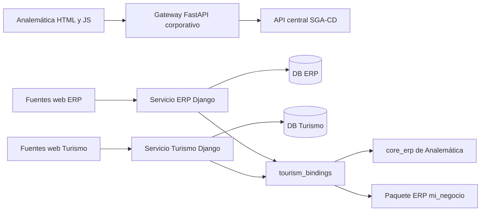

# Arquitectura observada, no propuesta de reescritura

Fuentes: BACKEND/deployment/compose.yaml, tourism_settings.py,
tourism_bindings.py y ANALEMATICA-BACKEND/deployment/api.py. Las flechas web
representan el destino configurado/previsto, no prueba de todos los flujos.
Los fragmentos de ruta del inventario no son endpoints resueltos. La API central
es una dependencia real del nodo corporativo; revisar solo deployment de
Analemática omitía sus fuentes ERP compartidas. El nuevo inventario las incluye.

La identidad SGA-CD y la Django siguen separadas. El vínculo empresarial validado
no es SSO y no convierte automáticamente roles entre sistemas. Bases separadas
no sustituyen filtros de autorización por empresa y jurisdicción.

Para relaciones de datos, el inventario conserva campo y destino declarado de
cada relación con archivo y línea. El diagrama previo en
INTEGRACIONES/turismo-erp/DIAGRAMA_DATOS.md es parcial/histórico y separa propuestas
no implementadas; no debe presentarse como esquema completo vigente. Los modelos
VerifiedCompanyLink, QuotationDraft y ErpSecurityEvent se auditan en las fuentes
actuales y sus migraciones fresh-local; no se infieren de ese diagrama anterior.

Roles objetivo y límites: INTEGRACIONES/turismo-erp/ROLES_Y_JURISDICCION.md.
302 declaraciones estáticas de permisos no prueban autorización efectiva en
todos los endpoints: puede haber herencia y reglas en get_queryset/servicios.
