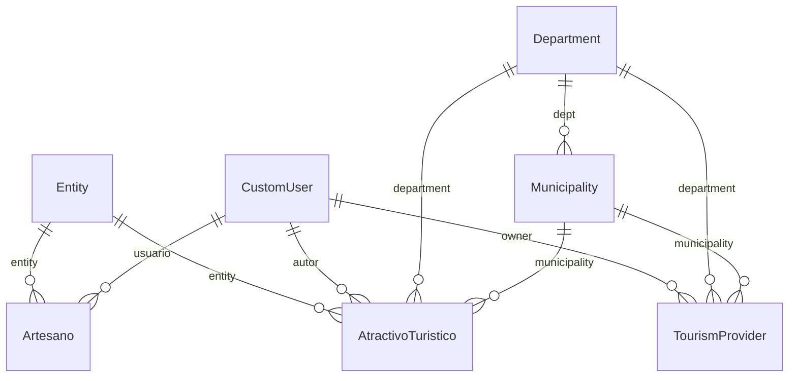
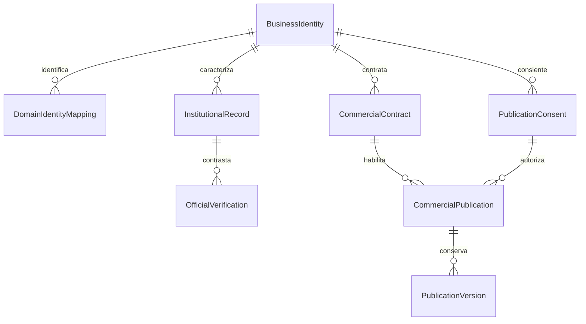

# Datos: evidencia parcial y diseño propuesto

Relaciones declaradas en las fuentes, no inferidas de una base productiva. El inventario JSON conserva campos, destinos de relaciones, archivos y líneas. Hay modelos homónimos en distintos paquetes; este diagrama usa los de `api.models` y `apps.turismo.models`.

Fuentes: `api/models.py`, `apps/turismo/models/provider_models.py`, `apps/turismo/models/divipola.py`. Nullable, on-delete y cardinalidad exacta deben comprobarse en migraciones/base real; el esquema simplifica los enlaces. `ProviderProfile` aparece como proxy del proveedor turístico, no una autorización de acceso al core Tenant.

Propuesta a revisar, todavía NO implementada:

No se ejecutó migración para esta propuesta. Restricciones de unicidad, tratamiento de sedes/establecimientos, cancelación contractual, conservación, campos publicables y mapeo territorial se definen antes de crear tablas. La desaparición de una promoción no debe borrar el registro institucional ni una evidencia oficial legítima.
