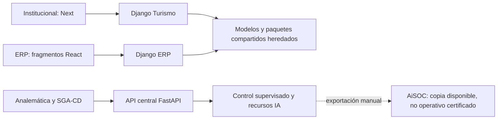
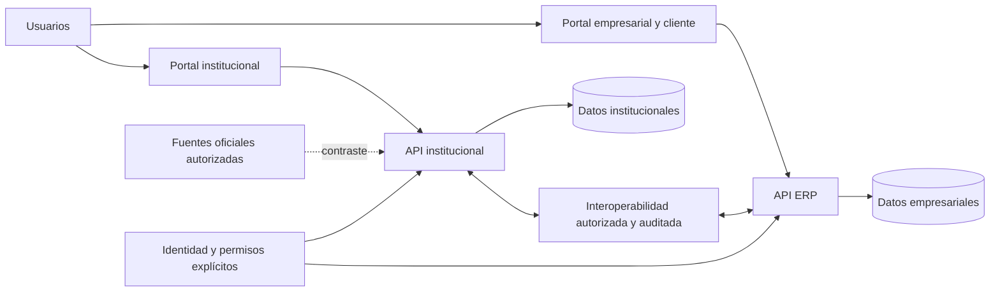

# Documento maestro de análisis, verificación y optimización turística

Versión inicial de auditoría, 6 de noviembre de 2026. Alcance recibido del propietario: Ecosistema Nacional de Gestión Turística de Colombia. Este documento organiza el trabajo; no certifica funciones que aún no se han probado. No se inicia una reescritura general.

## 1. Orden y método

Primero se consolida la base técnica común del plan maestro. Después se realiza el levantamiento institucional y se presentan sus hallazgos y plan. El ERP se aborda posteriormente, empezando por lo que percibe el cliente. Los inventarios estáticos preparados aquí son evidencia preliminar para esas etapas, no un sustituto del recorrido funcional.

La secuencia por módulo es: entender fuentes/dependencias → clasificar y presentar hallazgos → fijar aceptación y riesgos → desarrollar un cambio acotado → probar permisos, datos y regresiones → registrar evidencia. No se elimina ni sustituye un componente funcional sin justificar su dependencia y el cambio.

Estados exclusivos de la matriz:

- **IMPLEMENTADA:** propósito y recorrido E2E comprobados con evidencia reproducible, no solo archivo/pantalla.
- **PARCIAL:** implementación existente con límites verificados.
- **DEFECTUOSA:** fallo demostrado, incluyendo configuración de autorización incompatible con el propósito.
- **INEXISTENTE:** búsqueda/inventario suficiente demuestra que debe construirse; no se usa para algo que simplemente no encontramos.
- **OPTIMIZABLE:** funciona, pero una medición justifica la mejora.
- **NO VERIFICADA:** evidencia insuficiente. Es el estado inicial de casi todas las funciones del dominio.

## 2. Arquitectura actual y objetivo

La fuente institucional es Django/DRF en `BACKEND/SGA-TUR-BAKEND`, y el ERP vive en `BACKEND/SGA-ERP-TUR-BAKEND`. El backend institucional enlaza paquetes ERP y módulos corporativos mediante bindings. No son hoy dos productos totalmente independientes: comparten modelos, namespaces y configuración. El frontend institucional usa Next/React; el ERP importado es un fragmento que el preparador de vistas incorpora a un proyecto Next compartido. Analemática publica una consola y un gateway hacia FastAPI central.

Arquitectura objetivo: dos dominios independientes que intercambian información mediante contratos versionados, no importaciones arbitrarias o acceso directo a la base ajena. Cada dominio conserva autorización y propiedad de datos. La identidad común debe usar emisor, audiencia, tenant/jurisdicción y permisos explícitos; no se transfieren privilegios por nombres de rol parecidos.

El objetivo es una decisión de diseño, no una migración ejecutada. No se fusionan usuarios, empresas o bases automáticamente.

## 3. Registro institucional, RNT y publicación comercial

Son tres conceptos y ciclos de vida distintos:

1. **Registro institucional:** caracterización oficial/administrativa, con procedencia, jurisdicción, verificación y conservación legítima.
2. **RNT:** dato/requisito regulatorio cuando corresponda. Debe contrastarse con fuente oficial autorizada, con fecha, resultado y evidencia. Pagar pauta o activar una suscripción no lo valida ni lo reemplaza.
3. **Publicación comercial:** ficha promocional dependiente de contratación, consentimiento, revisión y vigencia.

Propuesta para evaluar, sin crear tablas todavía: `business_uid` estable y tabla de correspondencias entre IDs de dominio; registro institucional con versiones; verificación RNT separada; contrato comercial; consentimiento; solicitud/revisión/publicación; eventos idempotentes de actualización y retirada. No se usa el NIT, un nombre comercial ni un slug como única identidad de integración.

Al vencer o retirarse una pauta, se retira la promoción y se preserva la información institucional legítima. El alta empresarial no genera por sí sola inscripción oficial. Categorías y subcategorías deben versionarse y poder ampliarse. Los campos mínimos incluyen identificación, razón social, NIT/RNT según aplique, territorio, contactos autorizados, servicios, material promocional, accesibilidad, sostenibilidad, procedencia y fechas de actualización/verificación.

No se consultó una API oficial MinCIT/RNT/DIAN ni se verificó vigencia normativa en esta fase. No se inventan endpoints, permisos de acceso, categorías legales exhaustivas o certificados de cumplimiento. Esa validación es tarea explícita del plan.

## 4. Plataforma institucional: alcance verificable

Los 60 requisitos `INS-*` cubren:

| Módulo | Verificaciones requeridas |
|---|---|
| Panel institucional | Indicadores reales, pendientes, alertas, tareas, metas y trazabilidad de cifras. |
| Usuarios/entidades | Nacional, departamento, municipio; dependencias, jerarquías, altas y permisos funcionales. |
| Directorio PST | Categorías extensibles, identidad, territorio, verificación y separación de promoción/RNT. |
| Atractivos | Caracterización, coordenadas, evidencias, estado y escrituras con jurisdicción. |
| Ferias/fiestas | Calendario, programación, eventos y aprobación. |
| Artesanos | Caracterización, técnicas, comunidades, productos y promoción consentida. |
| Gestión/planificación | Planes, proyectos, compromisos, metas, evidencias e informes. |
| Analítica | Consolidación municipal/departamental/nacional, exportaciones y procedencia. |
| Documental | Expedientes, soportes, versiones, acceso privado y retención. |
| Portal público | Búsquedas, mapas, directorios, accesibilidad y adaptación móvil. |

Transversales: aprobación multinivel cuando aplique, historial, notificaciones, tareas, formularios dinámicos, importación/exportación, duplicados, auditoría, offline, evidencias e integraciones autorizadas. La consolidación nacional no implica permiso universal para modificar registros municipales.

## 5. ERP: primero el cliente

Los 85 requisitos `ERP-*` cubren los cinco módulos principales y sus extensiones. El primer recorrido a verificar será: identidad cliente → empresa seleccionada → catálogo/tarifa → disponibilidad → cotización/reserva → checkout → pago de prueba → confirmación → comprobante → modificación/cancelación → soporte/reseña. No se prueba un pago real ni se asume que mostrar checkout demuestre facturación.

| Área | Alcance |
|---|---|
| Portal cliente | Perfil, historial, cotizaciones, disponibilidad, reservas, compras, pagos, documentos, cambios, notificaciones, canales, reseñas, fidelización, promociones y PQR. |
| Experiencia comercial | Catálogo, condiciones/tarifas, calendario, cotizador, carrito, checkout, confirmación idempotente, comprobantes, recomendaciones y seguimiento. |
| Alojamiento | Fechas, huéspedes, habitaciones, tarifas, extras, check-in/out. |
| Gastronomía | Mesas, menú, pedidos, consumo y eventos. |
| Agencias/operadores | Paquetes, itinerarios, circuitos, pasajeros, tarifas y vouchers. |
| Guías/experiencias | Cupos, calendario, encuentro, reservas y asignación. |
| Transporte | Traslados, rutas, vehículos, pasajeros, horarios y confirmación. |
| Comercial ampliado | Micrositio, dominio, SEO, CRM, redes, WhatsApp, correo, cupones, embudos, canales, comisiones y conversión. |
| Cinco módulos | Comercial, archivístico, operacional, contable y financiero, habilitados modularmente por negocio. |
| Transversales | Personal/turnos, proveedores, inventario, mantenimiento, calidad/riesgos, contratos, multempresa/multidivisa, móvil/offline y analítica. |

Los paneles de propietario, administrador, profesional, técnico y asistencial deben diferir en operaciones permitidas y alcance, no solo en diseño. Los indicadores financieros requieren fuente y conciliación. DIAN, documentos fiscales e impuestos no se certifican por existir clases con esos nombres.

## 6. Evidencia e inventarios

- `inventario-tecnico.json`: clases/campos y relaciones declaradas, fragmentos de rutas, páginas/layouts y errores de sintaxis. Se genera sin ejecutar las aplicaciones ni leer datos privados.
- `matriz-funcional.csv` y `.json`: **155 requisitos** (60 institucionales, 85 ERP y 10 de interoperabilidad), con estado, evidencia, prioridad, riesgo, acción y aceptación.
- `HALLAZGOS.md`: defectos y riesgos localizados que requieren una decisión o una prueba.
- `ROLES_Y_JURISDICCION.md`: reglas objetivo y diferencias con los roles existentes.
- `DIAGRAMA_DATOS.md`: subconjunto de relaciones encontradas y propuesta separada.
- `PLAN_DESARROLLO.md`: prioridades, dependencias, aceptación y pruebas.
- `REGISTRO_Y_PRUEBAS.md`: modificaciones técnicas y evidencia ejecutada.

La auditoría inicial encontró cientos de modelos/rutas/páginas; los números exactos reproducibles están en el JSON. No se suman como funciones implementadas ni se afirma que todos los fragmentos de URL resuelvan. Las clases `Entity` y `Tenant` de distintos módulos no son automáticamente la misma entidad de negocio.

No se ha inspeccionado una base productiva ni se han recorrido todos los usuarios en navegador. Las bases SQLite versionadas no se migraron, borraron ni se usaron como datos reales de prueba. La disponibilidad de respaldos productivos y su restauración siguen NO VERIFICADAS.

## 7. Puertas de desarrollo y conservación

Antes de cada cambio de dominio: registrar archivos/dependencias, estado actual y criticidad; revisar grafo de migración y respaldo/restauración; publicar hallazgo y plan; construir pruebas de autorización, datos e idempotencia; modificar solo el alcance aprobado. Mantener interfaces compatibles o documentar la transición. No generar un pago/asiento, publicación o respuesta de seguridad ficticia para aparentar una integración terminada.

Después: pruebas unitarias e integración, aislamiento territorial y de empresa, integridad, consola/servidor, navegación, responsive y regresiones. Las pruebas sintéticas deben estar identificadas y aisladas; sus resultados no se presentan como actividad de clientes.

El control de equipos conserva dos autorizaciones separadas del mismo administrador solicitante y una confirmación de impacto. Los agentes de dominio heredados no quedan certificados ni autorizados por existir ese motor. Automatizaciones que produzcan efectos deben integrarse al contrato supervisado antes de activarse.
